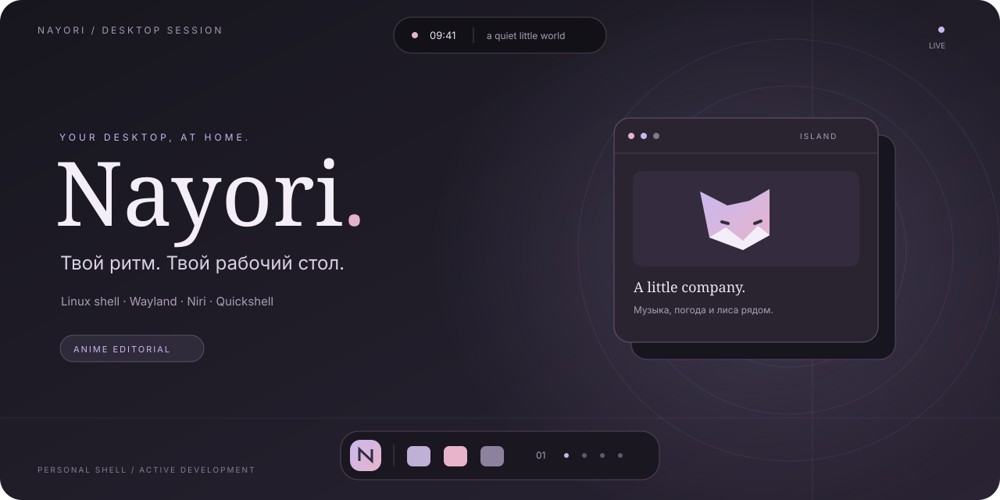

<div align="center">



# Nayori

**Личная оболочка Linux. Музыка, лиса и рабочий стол в твоём ритме.**

`WAYLAND` · `NIRI` · `QUICKSHELL / QML` · `В РАЗРАБОТКЕ`

[Возможности](#возможности) &nbsp; / &nbsp; [Запуск](#запуск) &nbsp; / &nbsp; [Зависимости](#зависимости) &nbsp; / &nbsp; [Документация](#документация)

<sub>Обложка — стилизованная иллюстрация, не скриншот оболочки.</sub>

</div>

---

Nayori — личная оболочка рабочего стола для Linux на Quickshell и QML, рассчитанная на Wayland и Niri. Основная среда разработки — CachyOS. Интерфейс следует стилю Anime Editorial: графитовые поверхности, лавандовые и розовые акценты, заголовки Literata и основной текст Inter.

## Возможности

| Рабочий стол | Всё рядом | Твой стиль |
| :--- | :--- | :--- |
| **Панель и «Пуск»**<br>Рабочие столы Niri, окна, приложения и поиск. | **Dynamic Island**<br>Музыка, тексты песен, погода и уведомления. | **Anime Editorial**<br>Графит, лаванда, розовый, Literata и Inter. |
| **Canvas**<br>Обои и режим отображения для каждого монитора. | **Лиса и Naomi**<br>Пиксельная кицунэ в острове и персонаж на рабочем столе. | **Материалы**<br>Solid, Frosted Glass и акцент по обоям. |

<details>
<summary><strong>Внутри оболочки — подробнее о возможностях</strong></summary>

- **Нижняя панель:** рабочие столы Niri, приложения и окна, системный лоток, сеть и звук. Остров приложений скрывается на пустом рабочем столе. Настраиваются автоскрытие и отступы для окон.
- **Dynamic Island:** часы, дата, музыка, громкость и лиса. Если в настройках острова включена смена даты и температуры, город задан и погода загружена, дата и температура сменяются сами: по умолчанию каждые 15 с, интервал от 5 до 120 с. Смена включена по умолчанию. Музыка, уведомление, индикатор громкости, развёрнутый остров и лаунчер эту смену останавливают. При наведении остров раскрывается на две страницы: «Главная» (музыка, погода и календарь) и «Уведомления». Страницы переключаются нажатием и колесом.
- **Лиса:** пиксельная кицунэ 52×30, нарисованная в коде (`surfaces/island/FoxSprite.js`), без файлов-кадров. При музыке или нагрузке CPU она встаёт и идёт на месте, без активности (после 5 с) ложится; в раскрытом острове голова и глаз следят за курсором, в свёрнутом — только при наведении на лису. Маркер уведомлений работает независимо от движений. При отключении анимаций лиса остаётся неподвижной. Рамка острова при музыке мягко меняет яркость по громкости выхода.
- **Музыка:** управление MPRIS-плеерами и выбор активного источника, включая приостановленный. Фон карточки — размытая обложка. Тексты автоматически ищутся в сети, синхронизируются с позицией трека и сохраняются в кэш. В раскрытой карточке можно переключать текст и метаданные. В свёрнутом острове показывается текущая строка только у текста с таймкодами.
- **«Пуск»:** меню открывается кнопкой, через IPC или отдельным нажатием Super (нужен обработчик клавиатуры). Меню одно на все мониторы: открытое закрывается повторным нажатием, закрытое открывается на активном мониторе.
- **Лаунчер:** `qs ipc call launcher toggle`, например по Alt+Space — строка поиска на месте острова на мониторе вызова, под ней карточка результатов: приложения и запрос в интернете, ↑↓, Enter, Escape. Справа плашка «Alt Space» напоминает сочетание открытия. Ввод попадает в поле сразу, без наведения мыши.
- **Naomi:** окно на рабочем столе, по умолчанию выключено и стоит справа снизу на основном мониторе. Облик выбирается в Настройки → Naomi → Внешний вид: текущая иллюстрация из слоёв (дыхание, волосы, шарф, моргание, ушки), Pixel art или Naomi v3. По умолчанию текущая. Настройка «Только на рабочем столе» выбирает слой Bottom (за окнами) или Top (поверх окон, под лаунчером и панелью). Naomi говорит в облачке (приветствие, редкие реплики, `qs ipc call naomi say "Текст"`). Текущая иллюстрация при поглаживании щурится, краснеет и склоняет голову; Pixel art переходит в довольную позу. Naomi v3 эту позу не рисует. Для поглаживания окно принимает ввод в небольшом овале над головой (клики там не проходят сквозь неё); переключатель «Реагировать на курсор» возвращает полностью прозрачное окно. Ещё Naomi коротко комментирует события системы (нагрузка CPU, терминалы и игры, много окон, низкий заряд, ночь, обновление, потеря сети, бездействие и возвращение); отключается переключателем «Комментировать системные события», проверяется `qs ipc call naomi trigger cpu`. Подробнее — [docs/NAOMI.md](docs/NAOMI.md).
- **Настройки:** отдельное окно с поиском разделов. Среди страниц: «Внешний вид» (материал Solid или Frosted Glass; акцент — лаванда Nayori, с обоев или свой цвет), «Обои» (папка с миниатюрами, монитор), «Панель задач» (автоскрытие, отступы, карточки мониторов), Naomi и «Интеграции». Доступность системных действий зависит от служб и утилит сессии.
- **Материалы:** Solid и Frosted Glass с общими токенами поверхностей и переключателем анимаций. Размытие фона использует поддержку композитора; без неё остаются полупрозрачные заливки.
- **Блокировка и вход:** Quiet Sidebar на основном мониторе, системные обои на каждом выходе и цвета текущей темы, включая динамическую. Блокировка использует Wayland session lock и PAM, показывает MPRIS-плеер. Экран входа — отдельная тема SDDM. [Подключение и проверки](docs/LOCKSCREEN.md).
- **Canvas:** статические обои на каждом мониторе, общий или индивидуальный выбор, предпросмотр и режимы Fill, Fit, Stretch и Center. Размытая копия обоев служит фоном обзора niri.
- **Буфер обмена:** журнал возле курсора со списком, поиском, закреплением, превью картинок и файлов видео, разрешением и размером. Открытие: `qs ipc -p /absolute/path/to/nayori call clipboard toggle`. Подробнее и пример бинда niri — в [docs/CLIPBOARD.md](docs/CLIPBOARD.md).
- **Захват экрана:** выбор области, редактор скриншотов со стрелками, рамками, текстом и блюром; запись области с паузой, звуком и управлением в капсуле левее часов. Папки и параметры — «Приложения → Запись экрана». [Зависимости и бинды](docs/CAPTURE.md).

</details>

Проект находится в активной разработке. Репозиторий не меняет другие оболочки, автозапуск, greetd или системные службы. Конфигурацию Niri оболочка не переписывает, но рядом с `config.kdl` создаёт свои фрагменты `nayori-accent.kdl` (акцент) и `nayori-overview.kdl` (фон обзора) и при необходимости добавляет на них include; если niri не принимает результат, прежний текст возвращается. Запись акцента и темы Strata (`~/.config/strata/themes/nayori.toml`) включена по умолчанию и выключается на странице «Интеграции». Подробности — в [архитектуре](docs/ARCHITECTURE.md) и [настройках](docs/SETTINGS.md).

## Запуск

Подставьте абсолютный путь к своей копии репозитория:

```sh
qs -p /absolute/path/to/nayori
```

Всегда указывайте путь явно. Корневая конфигурация — `shell.qml`; сборка приложения перед запуском не нужна. Не запускайте второй экземпляр поверх уже работающего с тем же назначением поверхностей.

Открыть настройки работающей оболочки:

```sh
/absolute/path/to/nayori/scripts/nayori-settings
/absolute/path/to/nayori/scripts/nayori-settings --page appearance
```

Открыть меню «Пуск» через IPC:

```sh
qs ipc -p /absolute/path/to/nayori call start toggle
```

### Уведомления

При обычном запуске Nayori не занимает `org.freedesktop.Notifications`. Чтобы включить приём, задайте переменную **при запуске оболочки**:

```sh
NAYORI_NOTIFICATIONS=1 qs -p /absolute/path/to/nayori
```

Если имя D-Bus уже занято другим демоном, Nayori оставляет его владельцу и сообщает о конфликте. Автоматического вытеснения нет.

В свёрнутом острове самое раннее непросмотренное уведомление закреплено в центре, справа — до трёх значков других приложений. Таймера смены нет. Открытие страницы «Уведомления» помечает записи просмотренными, и они уходят из свёрнутого острова. Если при раскрытии есть непрочитанные, остров сразу открывает эту страницу. Непрочитанность снимается, когда запись раскрывают, нажимают или удаляют. История хранится в памяти до перезапуска конфигурации.

### Музыка и тексты

Достаточно запустить плеер с MPRIS и трек с корректными метаданными. Поиск идёт в порядке:

**LRCLIB → AMLL TTML DB → NetEase → Kugou → QQ Music → lrc.cx → lyrics.ovh.**

Предпочтение отдаётся текстам с таймкодами. Обычный текст остаётся запасным вариантом; при отсутствии результата карточка показывает метаданные. Синхронизация использует позицию MPRIS, без распознавания речи. Приблизительное выделение слов без пословных таймкодов не является точной синхронизацией вокала.

Ручное скачивание LRC не требуется. Кэш находится в `$XDG_CACHE_HOME/nayori/lyrics` или `~/.cache/nayori/lyrics`. Доступность песен и сетевых источников может меняться. Подробности — в [документации музыки](docs/MUSIC_LYRICS.md).

## Зависимости

Для оболочки нужны:

- работающая сессия Niri/Wayland и пользовательская D-Bus-шина;
- Quickshell с используемыми модулями Wayland, MPRIS, PipeWire, SystemTray, Notifications, Networking, Bluetooth и UPower;
- Qt 6 с Qt Quick, Controls, Layouts, Dialogs и Effects; поддержка форматов изображений Qt нужна для обложек и обоев;
- Python 3 для вспомогательных процессов; сетевой поиск текстов использует стандартную библиотеку Python;
- PipeWire для звука, NetworkManager для управления сетью; Bluetooth и сведения о питании используют соответствующие службы системы;
- `curl` для погоды, `busctl` для проверки владельца сервиса уведомлений.

Дополнительно:

- `cava`, `parec` (утилиты PulseAudio) и PulseAudio-совместимый сервер PipeWire — музыкальная реакция лисы. Анализируется монитор системного выхода, поэтому в сигнал могут попадать звуки других приложений. MPRIS определяет, воспроизводится ли музыка; без анализатора сохраняется реакция на CPU.
- Шрифты **Inter** и **Literata** — предусмотренная типографика; без них Qt подбирает замену.
- `wl-clipboard` — сбор истории и копирование из журнала буфера; `ffprobe` и `ffmpeg` — размеры медиафайлов и кадры видео.
- `python-evdev` и доступ к устройствам ввода — распознавание отдельного нажатия Super. Для открытия «Пуска» кнопкой или IPC это не требуется.
- `xdg-mime`, `loginctl`/`systemctl`, установленный терминал, файловый менеджер и другие приложения — для соответствующих системных действий. Nayori не устанавливает их автоматически.

## Настройки и обои

Основные параметры сохраняются в `$XDG_CONFIG_HOME/nayori/settings.json`, по умолчанию — `~/.config/nayori/settings.json`. У Canvas отдельный файл `canvas.json` в том же каталоге. Изображения обоев хранятся ссылками на исходные файлы: после применения их нельзя перемещать или удалять без повторного выбора.

Для запуска без фоновых поверхностей Canvas:

```sh
NAYORI_CANVAS_DISABLED=1 qs -p /absolute/path/to/nayori
```

Это временно отключает поверхности и не меняет сохранённый выбор обоев.

## Проверки

GitHub Actions запускает CI при push, pull request и вручную через Actions → CI → Run workflow. Три задания в контейнере Arch Linux проверяют линтинг, логику и QML smoke-сценарии с offscreen-окнами и отдельной D-Bus-шиной.

Те же проверки локально:

```sh
bash scripts/ci-lint.sh
bash scripts/ci-tests.sh unit
dbus-run-session -- bash scripts/ci-tests.sh smoke
```

Зависимости CI перечислены в [`.github/workflows/ci.yml`](.github/workflows/ci.yml). Линтинг включает Qt 6 `qmllint`, Ruff, ShellCheck и проверку синтаксиса JavaScript и Bash. Ruff проверяет синтаксис и ошибки выполнения; ShellCheck блокирует диагностику уровня error. Для `qmllint` отключены проверки `missing-property` и `uncreatable-type`: описания типов Quickshell неполны. Образ Arch Linux обновляется при запуске, поэтому версии пакетов могут меняться.

Проверки живых Wayland-поверхностей, физического ввода и GPU выполняются отдельно на рабочем стенде командами ниже.

<details>
<summary><strong>Проверки, smoke-сценарии и Wayland-стенды</strong></summary>

Команды выполняются из корня репозитория. Для проверок нужны Qt 6 `qmllint`, Node.js, Python 3, `ripgrep`, Quickshell и стандартные shell-утилиты. D-Bus-сценарии используют `dbus-run-session`; проверка Canvas создаёт тестовые изображения через ImageMagick. Некоторые QML-сценарии используют QtTest.

```sh
bash scripts/check-island.sh
bash scripts/check-music.sh
bash scripts/check-canvas.sh
python3 tests/settings.py
python3 tests/weather-service.py
python3 tests/settings-window.py
python3 tests/settings-usage.py
python3 tests/super-tap.py
node tests/start-routing.cjs
node tests/island-routing.cjs
node tests/naomi-companion.cjs
python3 tests/launcher-focus.py
python3 tests/clipboard-store.py
node tests/clipboard-logic.cjs
python3 tests/naomi-layers.py
python3 tests/naomi-sprite.py
node tests/naomi-pixel.cjs
python3 tests/wallpaper-library.py
python3 tests/overview-backdrop.py
node tests/niri-accent.cjs
node tests/strata-theme.cjs
bash scripts/check-accent.sh
git diff --check
```

Smoke-конфигурации находятся в `tests/smoke/`. Ручной стенд лисы и уведомлений запускается отдельно:

```sh
qs -p /absolute/path/to/nayori/tests/smoke/IslandBehaviorSmoke.qml
```

Стенд подаёт искусственные CPU, аудиоэнергию, удары, наведение и уведомления; реальные источники данных в нём не запускаются. Автоматические сценарии используют offscreen-окна, временные каталоги и отдельные D-Bus-сессии. Изолированные проверки не подтверждают работу физического колеса, захвата реального аудио или GPU-размытия.

Проверки настоящих Wayland-поверхностей требуют доступа к рабочей сессии и могут создавать тестовые окна:

```sh
python3 tests/root-config.py
python3 tests/materials.py
NAYORI_NESTED_NIRI=1 python3 tests/launcher-focus.py  # вложенный niri: фокус лаунчера при открытии
python3 tests/clipboard-window.py                   # вложенный niri: окно буфера, фокус и анимация
python3 tests/settings-window.py --wayland
```

Для линтинга используется `/usr/lib/qt6/bin/qmllint`: одноимённая команда из `PATH` может относиться к другой версии Qt. Сценарии проверок содержат точные параметры и ожидаемые маркеры успешного завершения.

</details>

## Документация

- [Панель и Dynamic Island](docs/PANEL.md)
- [Лиса, уведомления и тестовый режим](docs/ISLAND_INTERACTION.md)
- [Музыка, источники текстов и кэш](docs/MUSIC_LYRICS.md)
- [Настройки и хранение](docs/SETTINGS.md)
- [Материалы и размытие](docs/MATERIALS.md)
- [Canvas и обои](docs/CANVAS.md)
- [Naomi: облако с репликами и поглаживание](docs/NAOMI.md)
- [Naomi v3](docs/NAOMI_SPRITE.md)
- [Журнал буфера обмена](docs/CLIPBOARD.md)
- [Скриншоты и запись экрана](docs/CAPTURE.md)
- [Архитектура](docs/ARCHITECTURE.md)
- [Дорожная карта](docs/ROADMAP.md)
- [Аудит AngelOS](docs/ANGELOS_AUDIT.md)

Nayori развивается как самостоятельная оболочка. Исследованные приёмы других проектов и решения об их использовании фиксируются в аудите.


---

<div align="center">


**Nayori** · Личный рабочий стол на Quickshell

<sub>Графитовые поверхности. Лавандовый свет. Лиса рядом.</sub>

</div>
